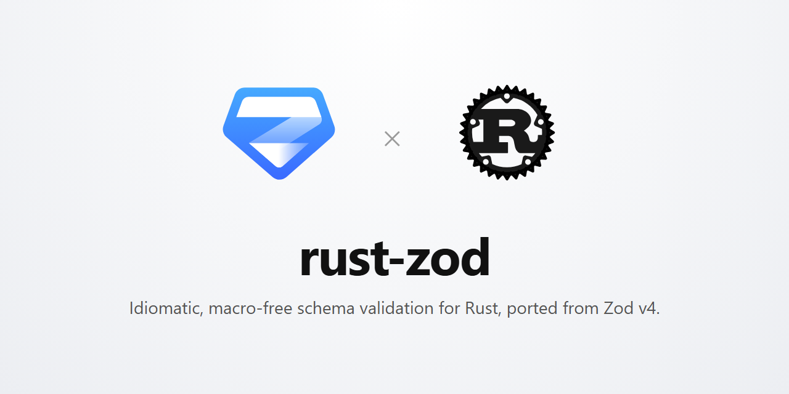

<div align="center">
  
</div>

<br/>

<div align="center">
  <h1>golang-zod</h1>
  <p><strong>Idiomatic, generics-based, zero-reflect runtime schema validation and serialization library for Go, faithfully ported from pure Zod v4.</strong></p>
</div>

<br/>

<div align="center">
  <a href="https://github.com/leandroluk/golang-zod/actions">
    
  </a>
  <a href="https://pkg.go.dev/github.com/leandroluk/golang-zod">
    
  </a>
  <a href="https://goreportcard.com/report/github.com/leandroluk/golang-zod">
    
  </a>
</div>

<br/>

`golang-zod` brings the developer experience (DX) of TypeScript's [Zod v4](https://github.com/colinhacks/zod) to the Go ecosystem: **no custom struct tags** (`z.Struct` reuses the standard `json` tag; `z.Object` needs none), **zero reflection at runtime**, **first-class i18n out of the box**, and an introspectable runtime schema model that exports effortlessly to **JSON Schema**, **OpenAPI 3.1**, and **GraphQL SDL**.

---

## Key Features

- 🎯 **Pure Zod v4 API**: Top-level format constructors (`z.Email()`, `z.UUID()`, `z.ISO.DateTime()`, `z.Int32()`), `.Meta(func(m *z.MetaBuilder) ...)` closure builders, and zero v3 deprecation baggage.
- ⚡ **Zero-Reflect Runtime**: `z.Struct[T]` runs reflection exactly once during schema definition; at runtime, fields are assigned directly via high-performance pointer offset mechanics with zero reflection overhead.
- 🚀 **High-Throughput Single-Pass Streaming**: `ParseJSON` and `Decode` read the input token by token with `jsontext` in a single pass; integers a `float64` cannot hold exactly (`Int64`, `Uint64`, `BigInt`) keep full precision.
- 🧩 **Zero-Allocation Inline Path Stack**: `parseCtx` uses an inline `[8]PathSegment` array for shallow paths with automatic spill to slice, yielding 0 allocs/op for path traversals during successful parses.
- 🌍 **Built-in i18n Error Catalog**: Full 11-variant Zod v4 issue taxonomy with pre-translated messages in English (`en`), Brazilian Portuguese (`pt-BR`), and Spanish (`es`), with automatic `Accept-Language` negotiation.
- 🔀 **Bidirectional Codecs**: `z.Codec(in, out, decode, encode)` and presets (`z.StringBool()`, `z.Codecs.*`) for reverse encoding and deserialization pipelines.
- 📐 **Universal Schema Exporters**: Generate JSON Schema (Draft 2020-12, Draft-07, Draft-04), OpenAPI 3.0/3.1, and GraphQL SDL with inverted nullability (`!`).
- 🔄 **Reverse JSON Schema Importer**: `z.FromJSONSchema(data)` builds dynamic runtime validation schemas from external schema specs.

---

## Quickstart

Install `golang-zod` using `go get`:

```bash
go get github.com/leandroluk/golang-zod
```

### 1. Declaring Schemas with Dynamic Objects (`z.Object`)

```go
package main

import (
	"fmt"
	z "github.com/leandroluk/golang-zod"
)

func main() {
	userSchema := z.Object(func(s *z.Shape) {
		s.Field("id", z.UUID())
		s.Field("email", z.Email())
		s.Field("name", z.String().Min(2).Trim())
		s.Field("age", z.Int().GTE(18).Optional())
		s.Field("role", z.Enum("admin", "member", "guest"))
	}).Meta(func(m *z.MetaBuilder) {
		m.ID("User").
			Title("User Profile").
			Describe("Registered system user entity")
	})

	input := map[string]any{
		"id":    "123e4567-e89b-12d3-a456-426614174000",
		"email": "alice@example.com",
		"name":  " Alice ",
		"age":   28,
		"role":  "admin",
	}

	user, err := userSchema.Parse(input)
	if err != nil {
		panic(err)
	}

	fmt.Printf("Validated: %v\n", user["name"]) // "Alice" (trimmed)
}
```

### 2. Concrete Go Structs with Zero-Reflect Runtime (`z.Struct`)

```go
type User struct {
	ID    string `json:"id"`
	Email string `json:"email"`
	Name  string `json:"name"`
	Age   int    `json:"age"`
}

var userStructSchema = z.Struct[User](func(s *z.StructShape, u *User) {
	s.Field(&u.ID, z.UUID())
	s.Field(&u.Email, z.Email())
	s.Field(&u.Name, z.String().Min(2).Trim())
	s.Field(&u.Age, z.Int().GTE(18))
})

func parseUser(rawJSON []byte) (User, error) {
	return userStructSchema.ParseJSON(rawJSON)
}
```

### 3. Context & Per-Request Locale Negotiation

```go
import "context"

func handleRequest(ctx context.Context, payload any, acceptLang string) {
	// Derive request context with negotiated language
	reqCtx := z.WithLocale(ctx, acceptLang)

	user, err := userSchema.Parse(payload, reqCtx)
	if err != nil {
		if zerr, ok := err.(*z.ZodError); ok {
			// Issues are translated automatically into pt-BR, es, or en
			for _, iss := range zerr.Issues() {
				fmt.Printf("[%s] %s: %s\n", iss.PathString(), iss.Code, iss.Message)
			}
		}
	}
}
```

---

## Zero-Reflect Runtime

`golang-zod` introduces a hybrid architecture for Go structs:
1. **Construction Bootstrap**: During `z.Struct[T](...)`, field pointers (`&u.Field`) are correlated to struct field offsets using `reflect`.
2. **Runtime Zero-Reflect Execution**: All runtime parse and validation calls assign values directly using typed pointer arithmetic (`unsafe.Add` confined strictly to `struct_unsafe.go`).
3. **No Reflection During Validation**: `reflect` is never imported or called during parsing, yielding sub-microsecond validation and minimal heap allocations.

---

## Zod v4 vs golang-zod

| TypeScript Zod v4 | golang-zod | Notes |
| :--- | :--- | :--- |
| `z.string().min(3)` | `z.String().Min(3)` | Chained validation methods |
| `z.email()`, `z.uuid()` | `z.Email()`, `z.UUID()` | First-class top-level formats |
| `z.object({ name: z.string() })` | `z.Object(func(s *z.Shape) { s.Field("name", z.String()) })` | Dynamic `map[string]any` output |
| `z.infer<typeof schema>` | `z.Struct[T](...)` | Direct typed struct compilation |
| `.describe("...")` | `.Meta(func(m *z.MetaBuilder) { m.Describe("...") })` | Fluent immutable metadata builder |
| `z.enum(["a", "b"])` | `z.Enum("a", "b")` | Generic variadic string enum |
| `z.union([a, b])` | `z.Union(a, b)` | First-matching candidate |
| `z.discriminatedUnion("type", [...])` | `z.DiscriminatedUnion("type", a, b)` | O(1) discriminator map dispatch |
| `z.lazy(() => schema)` | `z.Lazy(func() z.Schema[T] { return ... })` | Memoized recursive data structures |
| `z.codec(in, out, dec, enc)` | `z.Codec(in, out, dec, enc)` | Bidirectional serialization pipelines |
